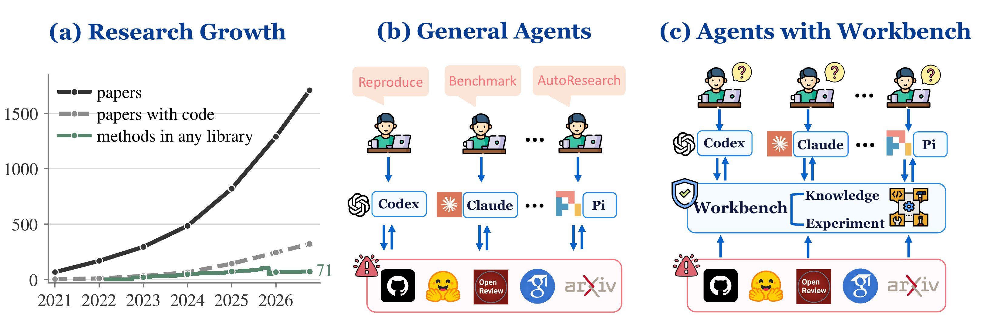
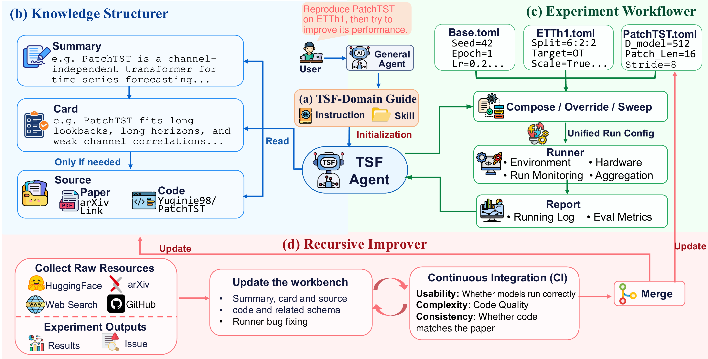
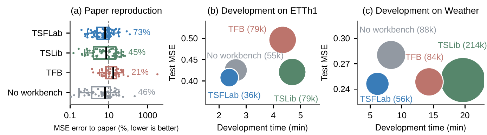
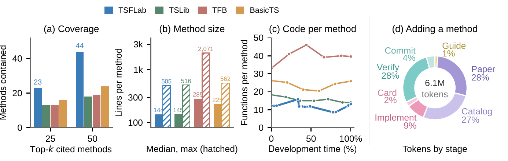

<div align="center">


# TSFLab

**A Self-Improving, Agent-Agnostic Workbench for Time Series Forecasting Research**

[](https://www.python.org/downloads/)
[](https://pypi.org/project/tsflab/)
[](https://github.com/astral-sh/uv)
[](https://pytorch.org/)
[](docs/en/models.md)
[](docs/en/models.md)
[](docs/en/workflows.md#data)
[](LICENSE)

</div>

TSFLab equips any compatible coding agent (Claude Code, Codex, Pi, ...) with shared,
verified resources and tools for time series forecasting (TSF) research: reproducing
papers, benchmarking methods on new data, and developing new methods. It ships no
agent of its own. The agent keeps its own model and harness; the workbench supplies
TSF knowledge, a structured catalog of methods, units, and datasets, and one
experiment runner, and it improves itself as agents add verified methods and fixes.

> 🧪 **Latest features land on the [`dev`](https://github.com/D2I-Group/TSFLab/tree/dev) branch first.** `main` is the stable, versioned release line.

---

## 🧭 Why a workbench

Forecasting papers grow much faster than released code: only about one in five of
the 1,707 arXiv TSF papers since 2020 links to code, and hand-maintained libraries
cannot keep up. Coding agents can reimplement and run methods, but used alone they
meet two problems:

1. **Slowly updated TSF knowledge.** An agent's knowledge stops at its training
   cutoff. Searching the web for every task is token-costly, and unchecked sources
   carry their errors forward (for example, the official Informer code dropped the
   last test batch, a setting many later studies inherited).
2. **Inconsistent research settings.** Agents that configure experiments on their
   own choose different splits, implementations, and metrics, so their results
   cannot be compared or shared, and the same experiments are repeated.

A *harness* is part of each agent; a *workbench* lies outside the agent and is shared
by all of them. A reproduction agent can add a verified implementation that a
benchmarking agent then reuses, and a development agent builds on both.

<p align="center">
  
</p>

---

## 🧩 How it works

<p align="center">
  
</p>

TSFLab has four modules:

| Module | What it gives the agent | In the repository |
| --- | --- | --- |
| **(a) TSF-Domain Guide** | Common TSF workflows, experimental settings, evaluation protocols, and known pitfalls, read when a task needs them | Entry instructions for the agent, 17 skills, and 5 task templates, loaded by any compatible agent |
| **(b) Knowledge Structurer** | One knowledge card per method, unit, and dataset, read level by level (summary → card → source), so agents decide without reading code and data | 326 methods as peers in one flat catalog, 72 shared components (RevIN, decompositions, attention variants, ...), 93 dataset presets with protocols; `tsf catalog` |
| **(c) Experiment Workflower** | One runner for agent-declared experiments: compose presets, override settings, sweep methods and values; validated before training, consistent splits, scaling, checkpoint selection, and metrics | `tsf run`, TOML sweeps, GPU leases, queues, recovery, run records |
| **(d) Recursive Improver** | Checks and integrates new methods, datasets, and fixes, so the workbench is updated independently of agent releases | Paper discovery, admission records in every card, `tsf repo check` (usability, complexity, consistency) before merge |

Each method card records its fidelity to the paper and pinned official code, the
components it uses, the data characteristics it fits, and the upstream issues found
in the official code.

---

## 📊 Results

We compare TSFLab with two existing TSF codebases, Time-Series-Library (TSLib) and
TFB, and with no workbench (an empty directory with PyTorch). All settings use
Codex CLI with GPT-6 Luna and identical prompts, data, network access, and budgets.

- **Paper reproduction:** reproduce the reported results of four recent papers that
  have no official code and are absent from all compared codebases (RhyMix, StateFlow,
  AdaRDiff, CoRe), three attempts each.
- **Benchmarking on new data:** benchmark eight methods (DLinear, PatchTST,
  iTransformer, TimeAlign, GTR, TimeMosaic, PHAT, EMAformer) on two new datasets
  (ERCOT, Openmeteo) under one protocol, three attempts each.
- **Method development (pilot):** on ETTh1 and Weather, search for a method with
  validation data, then evaluate the final choice once on test data.

Time, Tokens (fresh tokens, excluding cache reads), and Calls (tool calls) sum all
attempts, including failed ones, and are divided by the completed count. ΔLOC,
ΔFuncs, and ΔCC are the code lines, functions, and cyclomatic complexity added per
session. Best values are bold.

| Setting | Completed ↑ | Time (h) ↓ | Tokens (M) ↓ | Calls ↓ | ΔLOC ↓ | ΔFuncs ↓ | ΔCC ↓ |
| --- | ---: | ---: | ---: | ---: | ---: | ---: | ---: |
| ***Paper reproduction*** | | | | | | | |
| **TSFLab** | **12/12** | **1.96** | **0.434** | 159.67 | 148.08 | **8.25** | **25.83** |
| TSLib | 10/12 | 2.61 | 0.533 | 164.60 | 160.67 | 9.67 | 31.33 |
| TFB | 7/12 | 2.46 | 0.487 | **131.86** | 153.42 | 11.58 | 36.00 |
| No workbench | 8/12 | 3.50 | 0.706 | 212.75 | **131.00** | 11.00 | 34.00 |
| ***Benchmarking on new data*** | | | | | | | |
| **TSFLab** | **42/48** | **0.05** | **0.022** | **9.05** | **0.00** | **0.00** | **0.00** |
| TSLib | 30/48 | 0.06 | 0.035 | 12.50 | 180.33 | 9.17 | 52.17 |
| TFB | 16/48 | 0.08 | 0.065 | 18.88 | 345.67 | 30.33 | 76.50 |
| No workbench | 26/48 | 0.08 | 0.051 | 15.85 | 144.00 | 16.33 | 50.17 |

<p align="center">
  
</p>

<sub>(a) Reproduction MSE error relative to the paper (log scale; labels: share within 10%, 96 scheduled results). (b, c) Development test MSE versus time; bubble areas and labels show fresh tokens.</sub>

- **More tasks completed, more accurately.** TSFLab completes all 12 reproductions and
  42 of 48 benchmark results, and reproduces 73% of the scheduled results within 10%
  of the paper's MSE, against 21–46% for the other settings.
- **Lower cost.** Each completed outcome takes fewer tokens and less time; overall,
  completion rises by 20–163% and token cost falls by 11–66% across baselines.
- **Simpler added code.** Benchmarking needs no new code, since all eight methods are
  already in the catalog; in reproduction, agents add 15–29% fewer functions and
  18–28% less cyclomatic complexity.
- **Method development.** On ETTh1 and Weather, TSFLab reaches the lowest test MSE
  with 32.8–73.6% fewer fresh tokens and 9.2–68.8% less development time.

### Ablations

| Setting | Completed ↑ | Time (h) ↓ | Tokens (M) ↓ | Calls ↓ | ΔLOC ↓ | ΔFuncs ↓ | ΔCC ↓ |
| --- | ---: | ---: | ---: | ---: | ---: | ---: | ---: |
| Full TSFLab (Codex CLI, GPT-6 Luna) | **12/12** | **1.96** | 0.434 | 159.67 | 148.08 | **8.25** | 25.83 |
| w/o TSF-Domain Guide | 3/12 | 5.73 | 1.129 | 348.33 | 147.33 | 11.33 | 39.42 |
| w/o Knowledge Structurer | 8/12 | 2.08 | 0.438 | 118.75 | 171.42 | 9.42 | 31.58 |
| w/o Experiment Workflower | 5/12 | 2.24 | 0.533 | 153.00 | 178.75 | 10.42 | 36.42 |
| Claude Code, Sonnet 5.5 | 11/12 | 2.38 | **0.195** | **78.00** | 212.17 | 13.50 | 36.25 |
| Codex CLI, GPT-6 Sol | **12/12** | 2.88 | 0.394 | 82.25 | **132.17** | 9.25 | **23.67** |

Removing any module lowers completion, and each fails differently: without the guide,
agents write their own data loaders with wrong split boundaries; without the
Knowledge Structurer, they reuse fewer units and add more code; without the
Experiment Workflower, errors move into evaluation, such as tuning on test scores.
With the workbench, the lightweight GPT-6 Luna matches stronger agent configurations
in completion at a much lower estimated cost.

### Coverage and maintenance

<p align="center">
  
</p>

<sub>(a) Coverage of the top-cited methods. (b) Median and max model lines. (c) Functions per method over development. (d) Tokens to add one method, including cache reads.</sub>

- TSFLab contains **44 of the 50 most cited** TSF methods, against 29 across TSLib,
  TFB, and BasicTS combined.
- Implementations stay compact: median 144 lines (TSLib 145), largest 505 (TFB 2,071).
- Extracting shared components keeps code per method in check (average functions per
  method 11.9 → 8.6), and every function in the framework stays at cyclomatic
  complexity ≤ 10, enforced in CI.
- Writing model code is only 9% of the tokens spent adding a method; reading the paper,
  searching the catalog, and verification take the rest. Knowledge cards keep those
  findings so later agents do not repeat them.

<sub>The experiments used an earlier catalog version (311 methods, 63 components); the counts above the results describe the current release.</sub>

---

## 🏁 Quick start

**Work in the repository with an agent:**

```bash
git clone https://github.com/D2I-Group/TSFLab.git
cd TSFLab
codex          # or any other coding agent
```

```text
> Set up the environment for my GPU.
> Benchmark DLinear, PatchTST and iTransformer on ETTh1 and give me a leaderboard.
> Implement the paper at <arXiv URL> as a catalog model and admit it.
> Forecast this week's traffic round with PatchTST and submit it.
```

**Or install the framework and scaffold your own project:**

```bash
uv tool install "git+https://github.com/D2I-Group/TSFLab"   # provides `tsf`
tsf init my-forecasting-project --modules data,models,experiments,release,autoresearch
cd my-forecasting-project        # default: all modules; also writes the agent guide and skills
tsf data download etth1          # pinned, checksum-verified from the Hub
tsf run configs/runs/example.toml --dry-run
tsf run configs/runs/example.toml
```

For a fully specified task, `tsf run --model NAME --set KEY=VALUE --sweep
KEY=JSON_LIST` resolves the named preset without writing a config. It uses the
same validation and saves every expanded snapshot. `--gpus auto --jobs auto`
schedules visible idle GPUs; `--json --compact --output results/completion.json`
saves the returned results and artifact paths directly. Repeating a matrix with
the same output path reuses its sweep; use a new path for a different matrix.
A rejected request or preview preserves an existing execution report and returns
its diagnostic to the caller. `tsf catalog show NAME --params` returns only
accepted model parameters and constraints.

Scaffolded run configs inherit the installed catalog through `tsflab://`
paths, so upgrading TSFLab upgrades their defaults. Install by module with
extras: `tsflab[data]`, `[models]`, `[experiments]`, `[hub]`, `[realtime]`,
`[autoresearch]`, or `[all]`.

**Read the catalog progressively:**

```bash
uv run tsf catalog                                      # counts, then the next commands
uv run tsf catalog search "reversible normalization"    # L0: one line per match
uv run tsf catalog show PatchTST                        # L1: card facts and short README
uv run tsf catalog show revin --depth 2                 # L2: adds the reference (--depth 3: paths)
uv run tsf data analyze etth1                           # profile a dataset (train-only statistics)
uv run tsf catalog match etth1                          # models and components that fit its characteristics
uv run tsf realtime list
```

Search accepts `--kind model|component|dataset` and, for models, `--capability`.
See [docs/en/workflows.md](docs/en/workflows.md#reading-the-catalog).

---

## 📈 Rolling real-time evaluation

Each week the `weekly` workflow releases new observations (versioned on
the Hugging Face Hub), scores the rounds whose target window is now observed, and
opens a new round. Forecasts must be submitted **before** their targets exist, so
no model, including ours, can have seen its evaluation data.

| Track | Data | Setting | Horizon |
| --- | --- | --- | --- |
| `stock_hs300` | CSI-300 constituents, daily log returns (AKShare) | time series | 5 trading days |
| `stock_nasdaq100` | NASDAQ-100 constituents, daily log returns (Nasdaq API, Yahoo fallback) | time series | 5 trading days |
| `stock_sp500` | S&P 500 constituents, daily log returns (Nasdaq API, Yahoo fallback) | time series | 5 trading days |
| `traffic_pems_{ba,la,sac,sb}` | Caltrans PeMS Districts 4, 7, 3, 8: hourly flow at 2,472 / 1,926 / 801 / 1,105 stations | spatiotemporal | 24 h |
| `air_airnow_us` | EPA AirNow hourly PM2.5, US monitors (no key) | spatiotemporal | 24 h |
| `weather_openmeteo_temp`, `solar_openmeteo_ghi` | Open-Meteo hourly temperature at 82 US/EU cities, irradiance at 55 PV sites | spatiotemporal | 24 h |
| `grid_ercot` | ERCOT hourly load in 8 weather zones | spatiotemporal | 24 h |

```bash
uv run tsf realtime forecast --track traffic_pems_sb --model DLinear   # produce a forecast
uv run tsf realtime replay --track traffic_pems_sb --end 2023-12-25 --weeks 12   # backtest the protocol
```

Each track is also a frozen static dataset (`rt_<track>`, `tsf catalog list --kind dataset`). See [docs/en/realtime.md](docs/en/realtime.md).

---

## 🤝 Contributing

There are three ways to take part:

1. **Propose a method or report a problem** — open an *Add a paper* or *Report a
   problem or ask a question* issue. An agent triages it; accepted papers and
   reproducible fixes are checked with `tsf repo check`, reviewed by a second agent
   pass, and merged by the `agent` workflow.
2. **Submit results** — add a `submission.json` under `apps/web/submissions/`
   (see [SUBMITTING.md](apps/web/SUBMITTING.md)); CI validates it against the
   contract, and a maintainer moves it to the results repository on the Hugging
   Face Hub (`Diaugeia/TSFLab-Checkpoints`) that the leaderboard is built from.
3. **Forecast a real-time round** — add `forecasts/<YourModel>.json` to an open
   round before its deadline.

The literature is also scanned weekly by the `agent` workflow. See
[CONTRIBUTING.md](CONTRIBUTING.md) for code contributions.

---

## 📖 Documentation

- [Workflow documentation](docs/en/README.md): catalog, models, data, AutoResearch, admission, experiments
- [Projects and the Hub](docs/en/hub.md): `tsf init`, `hf://` assets, results and checkpoints (`TSFLab-Checkpoints`)
- [Real-time tracks](docs/en/realtime.md): rounds, forecasts, scoring, weekly automation

Exact command options stay in `tsf <command> --help`.

---

## 🗂️ Repository layout

| Path | Contents |
| --- | --- |
| `src/tsflab/` | One package per module, mirrored by the CLI: `catalog` (cards, registries, admission), `data`, `models` (flat catalog, `_components`, `_slots`), `experiments` (config, runner, evaluation, execution), `release` (Hub, submissions), `realtime`, `research` (rounds, recombination), `agent` (assets, tasks, `tsf init`), `core` (contracts), `cli` |
| `configs/`, `catalog/` | Run, model, and dataset presets, real-time track configs, `configs/fixtures/` (smoke and synthetic test inputs, not datasets), dataset cards, declined papers |
| `dataset/` | Local dataset bytes fetched with `tsf data download` (not packaged) |
| `apps/web/` | TSFLab Leaderboard: static site, submission pipeline, `submissions/`, real-time rounds |
| `experiments/` | Local research workspace (not tracked) |

---

## 📜 License

TSFLab is released under the [MIT License](LICENSE). Copyright © 2026 **Diaugeia.AI**.

Ordinary paper architectures are maintained locally under the project license.
Released pretrained foundation models use optional official packages and unchanged
checkpoints through the offline runtime boundary; see
[THIRD_PARTY_NOTICES.md](THIRD_PARTY_NOTICES.md). Real-time data remain subject to
their providers' terms (Caltrans PeMS, AirNow, Open-Meteo, ERCOT, and the stock
vendors behind AKShare, Nasdaq, and Yahoo). Each dataset card records its license
and redistribution class; `upstream` and `script` data are never re-hosted.

---

## ⭐ Star History

[](https://star-history.com/#D2I-Group/TSFLab&Date)
